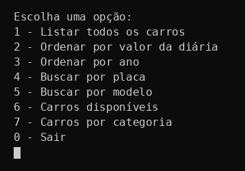
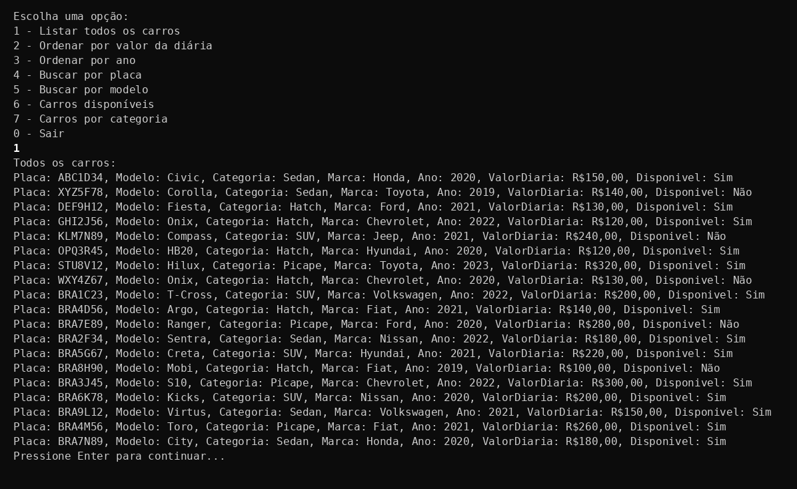
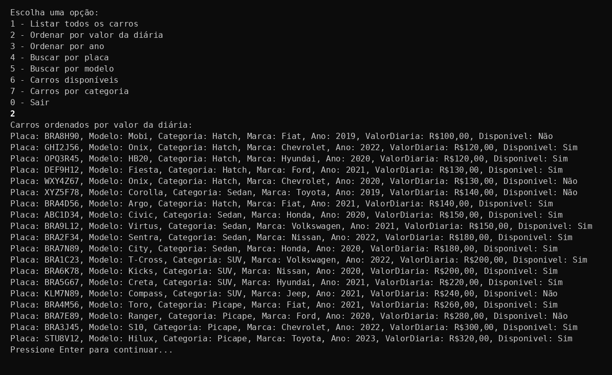
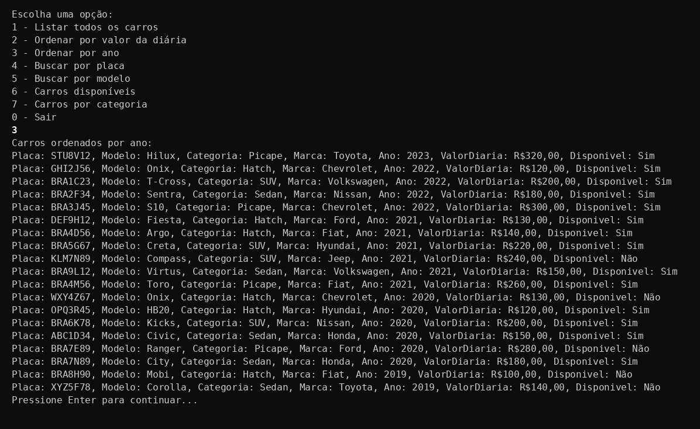
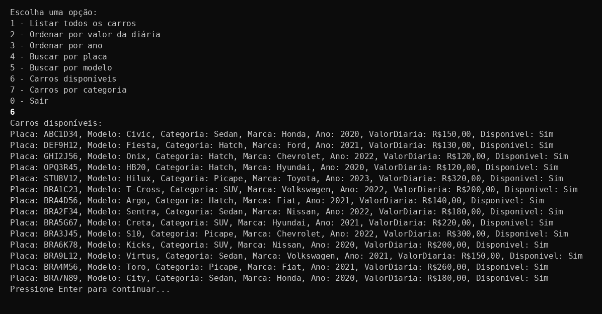
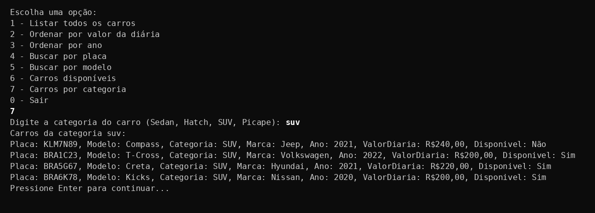
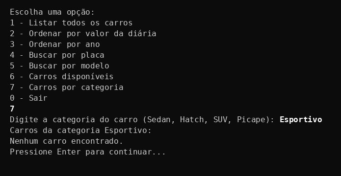
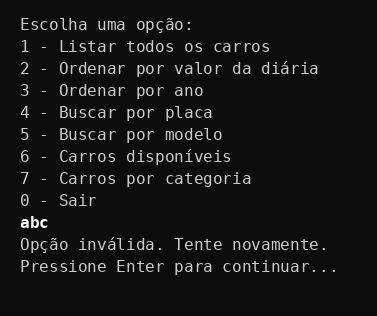

# Locadora de Carros

Sistema de console desenvolvido em C# para gerenciar uma frota de carros, permitindo ordenar, buscar e selecionar veículos por diferentes critérios.

Trabalho da disciplina Algoritmos e Estrutura de Dados II — TED 2º Bimestre — UniSapiens.

## Integrantes

- Bernardo Gonçalves Tagliavini
- Cauê de Sousa Tavernard
- João Vitor Nascimento dos Santos
- Marcus Vinicius Costa Pires
- Vinicius Nascimento Castrillon

## Sobre o projeto

O projeto simula o gerenciamento de uma locadora de carros por meio de uma aplicação de console em C#. A frota é armazenada em uma lista contendo 19 veículos.

O projeto aplica conceitos de estruturas de dados com a implementação manual de ordenação, busca e seleção.

## Funcionalidades

|   Tipo    |          Critério           |     Algoritmo    | Responsável |
|   ----    |        ------------         |    -----------   |  --------   |
| Ordenação | Valor da diária (crescente) | Bubble Sort      | Bernardo    |
| Ordenação | Ano (decrescente)           | Selection Sort   | Bernardo    |
| Busca     | Placa                       | Busca binária    | Vinicius    |
| Busca     | Modelo                      | Busca linear     | Vinicius    |
| Seleção   | Disponibilidade             | Filtro linear    | Marcus      |
| Seleção   | Categoria                   | Filtro linear    | Marcus      |

### Ordenação

- `OrdenarPorValorDiaria`: utiliza o algoritmo Bubble Sort para ordenar os carros pelo valor da diária do menor para o maior.
- `OrdenarPorAno`: utiliza o algoritmo Selection Sort para ordenar os carros do ano mais novo para o mais antigo.
- Ambos os métodos trabalham sobre uma cópia da lista original.

### Seleção

- `SelecionarDisponiveis`: percorre os carros linearmente e retorna somente aqueles cujo campo `Disponivel` é `true`.
- `SelecionarPorCategoria`: percorre os carros linearmente e retorna aqueles cuja categoria corresponde ao termo informado.
- A seleção por categoria ignora letras maiúsculas e minúsculas.
- Os dois métodos retornam uma nova lista e uma lista vazia quando nenhum carro corresponde ao filtro.

## Recursos adicionais

- Listar todos os carros.
- Buscar uma placa ignorando letras maiúsculas e minúsculas.
- Buscar modelos com termos parciais.
- Selecionar carros disponíveis.
- Selecionar carros por categoria.

## Tecnologias

- C# / .NET 10
- Visual Studio Code
- Git e GitHub

## Como executar

Pré-requisito: [.NET 10 SDK](https://dotnet.microsoft.com/download)

```bash
git clone https://github.com/joao-vitor-santosz/locadora-de-carro.git
cd locadora-de-carro/LocadoraCarros
dotnet run
```

## Como usar

```text
1 - Listar todos os carros
2 - Ordenar por valor da diária
3 - Ordenar por ano
4 - Buscar por placa
5 - Buscar por modelo
6 - Carros disponíveis
7 - Carros por categoria
0 - Sair
```

## Estrutura

```
LocadoraCarros/
├── Models/Carro.cs           # Modelo do carro
├── Dados/BaseDeCarros.cs     # Lista inicial com 19 carros
├── Algoritmos/
│   ├── Ordenacao.cs          # Ordenação por diária e ano
│   ├── Busca.cs              # Busca por placa e modelo
│   └── Selecao.cs            # Seleção por disponibilidade e categoria
└── Program.cs                # Menu principal
```

## Organização das classes

- Carro: representa os dados de um veículo.
- BaseDeCarros: fornece a lista inicial da frota com 19 carros.
- Ordenacao: contém os métodos de ordenação da frota.
- Busca: contém os métodos de busca por placa e modelo.
- Selecao: contém os métodos de seleção por disponibilidade e categoria.
- Program: apresenta o menu e realiza a interação com o usuário.

## Decisões de implementação

- Os métodos não alteram a lista original; trabalham sobre uma cópia.
- Os métodos não podem utilizar `Sort()`, `OrderBy()`, `Where()`, `Find()` ou `BinarySearch()`.
- A busca por placa deve ignorar letras maiúsculas e minúsculas.
- A busca por modelo deve aceitar termos parciais.
- Os filtros por disponibilidade e categoria devem retornar uma nova lista.
- Os métodos que não encontram resultados devem retornar uma lista vazia.
- A busca por placa deve retornar `null` quando o carro não existir.
- A seleção por disponibilidade e categoria utiliza percursos lineares da lista.

## Telas

### Menu Principal


### Lista completa


### Ordenação por valor da diária


### Ordenação por ano


### Disponíveis


### Categoria SUV


### Categoria inexistente


### Opção inválida
